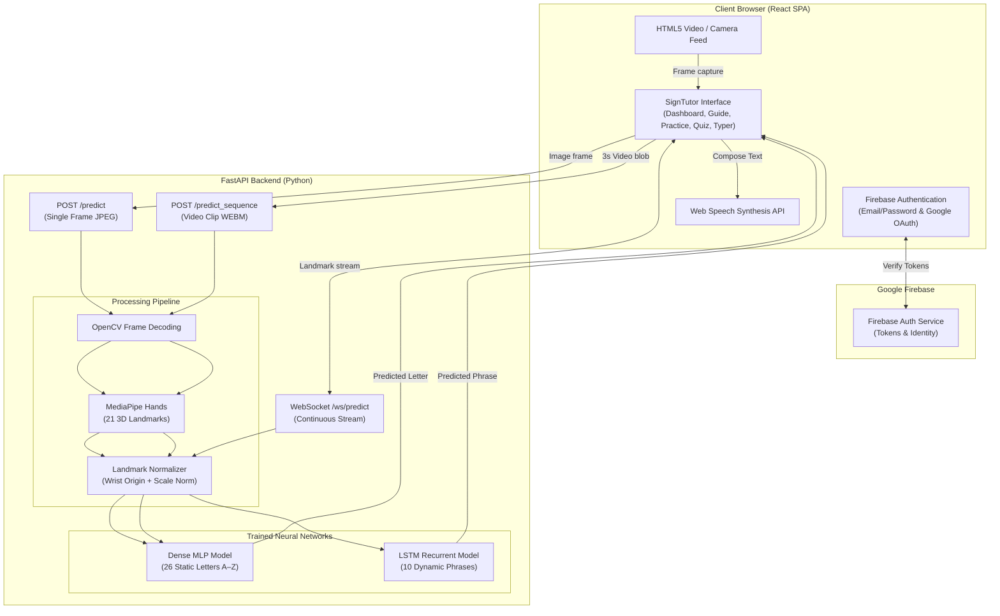

# HandSpeak — AI-Powered Sign Language Tutor

An interactive web application that helps users learn, practice, and test American Sign Language (ASL) in real time using computer vision and machine learning.

---

## Table of Contents

1. [Project Overview](#1-project-overview)
2. [Problem Statement](#2-problem-statement)
3. [Objectives](#3-objectives)
4. [Key Features](#4-key-features)
5. [Technologies Used](#5-technologies-used)
6. [Project Architecture](#6-project-architecture)
7. [How the Project Works](#7-how-the-project-works)
8. [Installation and Setup](#8-installation-and-setup)
9. [How to Run the Project](#9-how-to-run-the-project)
10. [Project Folder Structure](#10-project-folder-structure)
11. [Implementation Details](#11-implementation-details)
12. [Future Scope](#12-future-scope)
13. [Conclusion](#13-conclusion)

---

## 1. Project Overview

**HandSpeak** (also branded as **SignTutor**) is an educational web platform designed to make learning American Sign Language accessible and interactive. 

Traditional ways of learning sign language—such as reading books or watching pre-recorded videos—are one-sided. Learners see the hand shapes, but they cannot verify whether their own hand gestures are accurate. HandSpeak solves this problem by using standard computer webcams and deep learning models to track hand landmarks and give instant, real-time feedback.

The application includes a complete user authentication system, personal progress tracking, an interactive visual dictionary, real-time sign detection, quizzes, vocabulary spelling drills, dynamic phrase recognition, and a sign-to-speech composer.

---

## 2. Problem Statement

Over 70 million Deaf and hard-of-hearing individuals worldwide use sign language as their primary mode of communication. However, very few hearing people know even basic sign language, creating a significant everyday communication barrier.

Most existing digital resources for sign language suffer from two main issues:
- **No live feedback:** Video tutorials cannot tell a user if their fingers are positioned correctly.
- **Expensive equipment:** Some research solutions require specialized sensory gloves or depth cameras that regular students and learners cannot afford.

There is a clear need for an affordable, software-only solution that runs in any standard web browser using an ordinary webcam and provides reliable, real-time guidance.

---

## 3. Objectives

The primary goals of this project are:

1. **Real-Time Recognition:** Recognize static ASL alphabet signs (A–Z) from a standard webcam stream with low latency.
2. **Dynamic Phrase Recognition:** Recognize moving gesture phrases (such as *"Thank you"*, *"Hello"*, and *"Help"*) using video sequence modeling.
3. **Structured Learning Experience:** Provide interactive exercises including an ASL visual dictionary, alphabet recall quizzes, spelling bees, and full-sentence composition.
4. **User Authentication & Privacy:** Protect application access using secure email/password and Google OAuth authentication.
5. **Personalized Progress Tracking:** Maintain individual dashboards for each user to track accuracy, question counts, heatmaps, and weak spots.
6. **Accessible UI:** Deliver a responsive web interface with Dark Teal, Light, and System appearance options.

---

## 4. Key Features

### User Authentication Gate
- **Protected Access:** The login and sign-up page is the first screen shown when opening the app. Unauthenticated users cannot access the tutor.
- **Multiple Auth Methods:** Supports email/password registration and sign-in, as well as one-click Google OAuth authentication.
- **Password Recovery:** Built-in "Forgot Password" link sends a reset email to the user.
- **Session Persistence:** Users remain securely signed in across browser refreshes.

### Personalized Analytics Dashboard
- **Per-User Isolation:** Each learner has their own independent progress record. One user never sees another user's scores or history.
- **Key Metrics:** Shows total questions answered, global accuracy percentage, and daily practice goals.
- **Alphabet Heatmap:** A visual 26-letter grid color-coded by performance (green for good, yellow for average, red for needs review, muted for unpracticed).
- **Weak Spots & Leaderboards:** Highlights the user's lowest accuracy letters and ranks their fastest/slowest recognized signs.
- **Recent Activity Log:** Displays a table of the user's last 10 practice attempts with timestamps and outcomes.

### ASL Visual Dictionary Guide
- **Complete A–Z Reference:** Displays clear hand-illustration cards for all 26 English alphabet letters in American Sign Language.
- **Theme-Adaptive Visuals:** Uses custom image contrast filters so black-outline sign drawings appear bright white in Dark Mode and dark charcoal in Light Mode.
- **Interactive Inspection Modal:** Clicking any card opens an enlarged detail view with signing hints and a direct shortcut to practice that letter in live camera mode.
- **Instant Search:** Allows users to quickly filter and find any letter.

### Live Practice Mode
- **Real-Time Translation:** Users hold up any ASL hand shape to the webcam and receive instantaneous letter prediction.
- **Bold Translation Card:** The recognized letter is prominently highlighted in high-contrast aqua/teal typography.
- **Clean Camera Interface:** Includes an inactive standby card, clean enable/stop controls, and live status indicators.

### Alphabet Quiz
- **Fingerspelling Recall:** Prompts the user with a random letter and a 5-second countdown to sign it correctly to the webcam.
- **Live Match Verification:** Shows what the user is currently signing alongside the target letter so they can adjust their hand.
- **Scoring & Completion:** Automatically grades 30 questions per round and displays a performance summary upon completion.

### Spelling Bee Drill
- **Vocabulary Practice:** Loads random English words (via a live word API with a 100-word offline fallback) and asks the user to fingerspell each letter.
- **Visual Block Progression:** Each letter block changes color in real time (current, success, or danger) as the user spells the word.

### Phrase Drills
- **Temporal Motion Recognition:** Evaluates dynamic multi-frame gestures (e.g., *"Hello"*, *"Thank you"*, *"Yes"*, *"No"*, *"Help"*, *"Sorry"*, *"Eat"*, *"Bye"*, *"Stop"*, *"Welcome"*).
- **Automated Video Capture:** Records a 3-second sequence in-browser, sends it to the backend LSTM model, and returns match confirmation.

### Sign & Speak (Sentence Composer)
- **Real-Time Composition:** Combines sequentially recognized letters into words and sentences.
- **Keyboard Support:** Supports standard space bar for spaces and backspace for corrections.
- **Text-to-Speech (TTS):** Uses the browser's native Web Speech API to read the completed sentence out loud at a natural pace.

### Appearance Modes
- **Dark Mode:** Dark charcoal background (`#0B1215`) with subtle teal surfaces (`#142328`) and aqua highlights (`#2DD4BF`).
- **Light Mode:** Crisp, clean background (`#F6FAF9`) with white cards and dark teal accents (`#0F9488`).
- **System Mode:** Automatically matches the operating system's color scheme with zero-flicker loading.

---

## 5. Technologies Used

### Frontend
- **React 19:** Single-page application framework for building reactive user interfaces and managing state.
- **Firebase v10+ (Authentication):** Handles email/password authentication, Google OAuth popups, and secure user session tokens.
- **Custom CSS Variables:** Complete design system supporting Dark, Light, and System themes without bulky external component libraries.
- **MediaRecorder API:** Captures in-browser `.webm` video clips from the webcam for phrase recognition.
- **Web Speech API (`SpeechSynthesis`):** Provides client-side text-to-speech for vocalizing composed sentences.

### Backend
- **Python 3.10:** Programming language used for server-side logic and machine learning inference.
- **FastAPI:** High-performance, asynchronous web framework used to expose REST API endpoints and WebSocket channels.
- **Uvicorn:** Production-ready ASGI server used to run the FastAPI application.
- **OpenCV (`cv2`):** Decodes incoming image buffers and handles video frame capture.
- **NumPy:** Handles multi-dimensional matrix operations and landmark array transformations.

### Machine Learning & Computer Vision
- **Google MediaPipe Hands:** Extracts 21 3D hand coordinates ($x, y, z$) per hand from image and video frames.
- **TensorFlow & Keras:** Machine learning library used to train and run inference on the neural network models.
  - **Dense MLP Model (`landmark_model.keras`):** Multi-layer perceptron trained on normalized 63-feature landmark vectors to classify 26 static letters.
  - **LSTM Model (`sequence_model.keras`):** Long Short-Term Memory neural network trained on 60-frame sequences (126 features per frame) to classify 10 dynamic phrases.

---

## 6. Project Architecture

The following diagram illustrates the interaction between the frontend, backend, and machine learning components:



---

## 7. How the Project Works

### Step 1: User Signs In
1. The user opens the web application.
2. The authentication gate checks if an active session exists.
3. If not signed in, the user enters email/password or clicks "Continue with Google".
4. Once authenticated, the user is redirected to their personalized Dashboard.

### Step 2: Camera Feed & Hand Detection
1. When entering Practice, Quiz, or Drill modes, the user clicks **Enable Camera Feed**.
2. The browser accesses the webcam via `navigator.mediaDevices.getUserMedia`.
3. The video stream is mirrored horizontally for a natural mirror-like experience.

### Step 3: Frame Processing & Feature Extraction
1. The frontend periodically grabs frames from the video element and sends them to the backend (`/predict`).
2. The backend uses MediaPipe Hands to locate 21 hand joints (such as wrist, knuckles, finger tips).
3. Each joint has three coordinates ($x, y, z$), producing 63 raw values per hand.

### Step 4: Landmark Normalization
Raw pixel coordinates vary depending on how close or far the hand is from the camera, or whether the user is left-handed or right-handed. To solve this:
1. **Origin Translation:** The wrist coordinate $(x_0, y_0, z_0)$ is subtracted from all other 20 joints, anchoring the wrist at $(0, 0, 0)$.
2. **Handedness Correction:** If a left hand is detected, the horizontal coordinate ($x$) is inverted so the model sees a standard right-hand configuration.
3. **Scale Normalization:** All coordinates are divided by the maximum distance from the wrist to any fingertip. This makes recognition independent of hand size and distance from the webcam.

### Step 5: Model Inference & Instant UI Feedback
1. The normalized 63-dimensional array is passed into the static MLP model.
2. The model outputs prediction probabilities across all 26 alphabet letters.
3. The highest probability class is returned to the frontend.
4. The React interface checks for stable consecutive detections (to prevent flickering) and updates the large bold display card, advances the quiz, or appends the letter to the sentence composer.

---

## 8. Installation and Setup

### Prerequisites
Make sure you have the following installed on your machine:
- **Python 3.10** (recommended for TensorFlow compatibility)
- **Node.js** (v18 or higher) and **npm**
- A working **Webcam**
- A **Google Firebase** project (free Tier)

---

### Step 1: Clone the Repository

```bash
git clone https://github.com/srishtisharma07/HandSpeak.git
cd HandSpeak
```

---

### Step 2: Backend Setup

1. Open a terminal and navigate to the `backend/` directory:
   ```bash
   cd backend
   ```

2. Create a Python virtual environment:
   ```bash
   # Windows
   python -m venv venv
   venv\Scripts\activate

   # macOS / Linux
   python3 -m venv venv
   source venv/bin/activate
   ```

3. Install the required backend dependencies:
   ```bash
   pip install -r requirements.txt
   ```

---

### Step 3: Frontend Setup

1. Open a second terminal window and navigate to the `frontend/` directory:
   ```bash
   cd frontend
   ```

2. Install Node.js packages:
   ```bash
   npm install
   ```

3. Configure Firebase environment variables:
   - Create a file named `.env` in the `frontend/` folder.
   - Copy the contents from `frontend/.env.example` into `frontend/.env`:
     ```env
     REACT_APP_FIREBASE_API_KEY=your_actual_api_key
     REACT_APP_FIREBASE_AUTH_DOMAIN=your_project_id.firebaseapp.com
     REACT_APP_FIREBASE_PROJECT_ID=your_project_id
     REACT_APP_FIREBASE_STORAGE_BUCKET=your_project_id.appspot.com
     REACT_APP_FIREBASE_MESSAGING_SENDER_ID=your_sender_id
     REACT_APP_FIREBASE_APP_ID=your_app_id
     ```
   - In your [Firebase Console](https://console.firebase.google.com), ensure that **Email/Password** and **Google** sign-in providers are enabled under **Authentication → Sign-in method**.

---

## 9. How to Run the Project

Both the backend API server and frontend development server must run simultaneously.

### 1. Start the Backend Server

In your backend terminal (with the virtual environment activated):

```bash
cd backend
uvicorn main:app --reload --host 127.0.0.1 --port 8000
```

- Backend API will run at: `http://127.0.0.1:8000`
- Interactive API Documentation (Swagger): `http://127.0.0.1:8000/docs`

### 2. Start the Frontend Application

In your frontend terminal:

```bash
cd frontend
npm start
```

- The React application will automatically open in your default browser at `http://localhost:3000`.

---

## 10. Project Folder Structure

```
HandSpeak/
├── backend/                        # FastAPI backend application
│   ├── main.py                     # API endpoints (/predict, /predict_sequence, /ws/predict)
│   └── requirements.txt            # Python dependencies (FastAPI, TensorFlow, OpenCV, MediaPipe)
│
├── frontend/                       # React 19 single-page application
│   ├── public/                     # Static assets & HTML template
│   │   ├── index.html              # HTML shell with theme initialization script
│   │   └── data/guide_images/      # 26 high-resolution ASL alphabet sign PNGs
│   ├── src/
│   │   ├── App.js                  # Main React application, routes, and practice components
│   │   ├── App.css                 # Global theme variables (Dark/Light/System) & layout styling
│   │   ├── AuthPage.js             # Modern split-screen authentication component
│   │   ├── AuthPage.css            # Authentication styling
│   │   ├── firebase.js             # Firebase client SDK initialization & auth exports
│   │   ├── index.js                # React DOM entry point
│   │   └── index.css               # Base font settings
│   ├── .env.example                # Template for Firebase credentials
│   ├── package.json                # Frontend dependencies and scripts
│   └── .gitignore                  # Frontend-specific ignores (keeps .env safe)
│
├── models/                         # Pre-trained deep learning models
│   ├── landmark_model.keras        # Trained MLP for 26 static ASL letters
│   ├── landmark_labels.npy         # Class labels array for the static model
│   ├── sequence_model.keras        # Trained LSTM for 10 dynamic ASL phrases
│   ├── sequence_labels.npy         # Class labels array for the sequence model
│   ├── phrase_model.keras          # Reference baseline phrase model
│   └── phrase_labels.npy           # Labels for the reference model
│
├── src/                            # Shared utilities and helper scripts
│   ├── utils/
│   │   └── landmark_normalizer.py  # Wrist-relative scale and handedness normalization
│   ├── collect_landmarks.py        # Script to collect custom hand landmarks
│   └── train_landmark_model.py     # Training pipeline for static landmark model
│
├── scripts/                        # Dataset collection and sequence training scripts
│   ├── 01_collect_sequences.py     # Captures 60-frame gesture sequences
│   ├── 02_train_sequence_model.py  # Trains the temporal LSTM model
│   ├── augment_data.py             # Data augmentation for sequence arrays
│   └── test_realtime.py            # Local OpenCV camera test script
│
├── .gitignore                      # Root Git ignore file
└── README.md                       # Complete project documentation
```

---

## 11. Implementation Details

### Landmark Normalizer (`src/utils/landmark_normalizer.py`)
To ensure reliable recognition regardless of where the user places their hand in front of the camera:
1. **Wrist Subtraction:** Moves landmark coordinates to wrist-relative space.
2. **Horizontal Flipping:** Inverts the $x$-axis coordinate for left hands to ensure uniform hand geometry.
3. **Bounding Distance Scaling:** Normalizes coordinates so the maximum joint distance equals 1.0.

### Static MLP Model (`models/landmark_model.keras`)
- **Input:** 63 floating-point numbers ($21 \text{ landmarks} \times 3 \text{ coordinates}$).
- **Architecture:** Fully connected dense layers with ReLU activation, Dropout regularization (to prevent overfitting), and a final Softmax layer with 26 outputs.
- **Accuracy:** Over 95% accuracy on validated static ASL finger-spelling benchmarks.

### Dynamic LSTM Model (`models/sequence_model.keras`)
- **Input:** $60 \text{ frames} \times 126 \text{ features}$ (two hands $\times$ 63 landmarks each, zero-padded if only one hand is visible).
- **Architecture:** Stacked LSTM recurrent layers designed to learn motion trajectories over time, followed by dense classification layers.
- **Confidence Threshold:** Predictions must exceed 70% confidence to trigger a match, preventing false positives during movement transitions.

### User Dashboard Persistence
- **Storage Strategy:** Instead of sharing an insecure global key across users, statistics are stored under `signLanguageStats_${uid}`.
- **Data Saved:** Records every letter attempted, success status (true/false), and recognition response time in seconds.
- **Computed Metrics:** Dynamically computes per-letter accuracy, heatmap categories, weakest letters, fastest signs, and recent activity logs.

---

## 12. Future Scope

While HandSpeak is fully functional for static finger-spelling and common phrase recognition, several exciting enhancements are planned:

1. **Two-Handed Continuous Sentence Translation:** Expanding the temporal model to recognize continuous full-grammar sentences involving simultaneous two-hand movements.
2. **Facial Expression Integration:** Adding MediaPipe Face Mesh to capture grammatical facial expressions (non-manual markers) essential in natural ASL conversation.
3. **Mobile Application:** Building a cross-platform mobile app using React Native to allow learning on smartphones without a computer.
4. **Cloud Database Sync:** Syncing dashboard statistics across multiple devices using Firebase Cloud Firestore.
5. **Gamified Learning Paths:** Introducing progressive difficulty levels, daily challenge streaks, and peer leaderboards.

---

## 13. Conclusion

**HandSpeak** demonstrates how modern machine learning and computer vision techniques can be effectively integrated into a web-based educational tool. By removing the need for specialized hardware and providing immediate, real-time feedback, the system offers an engaging, accessible, and self-paced environment for learning American Sign Language.

---

## 📄 License

This project is licensed under the [MIT License](LICENSE).
