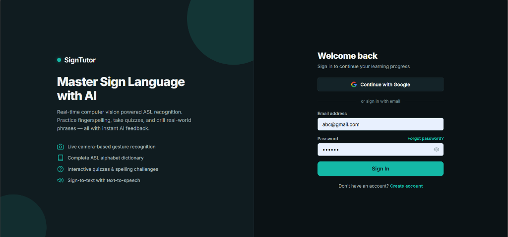
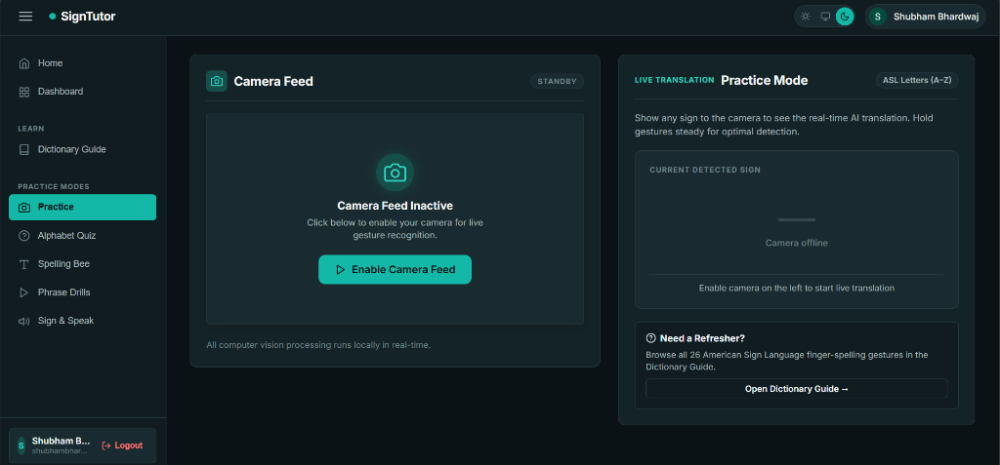
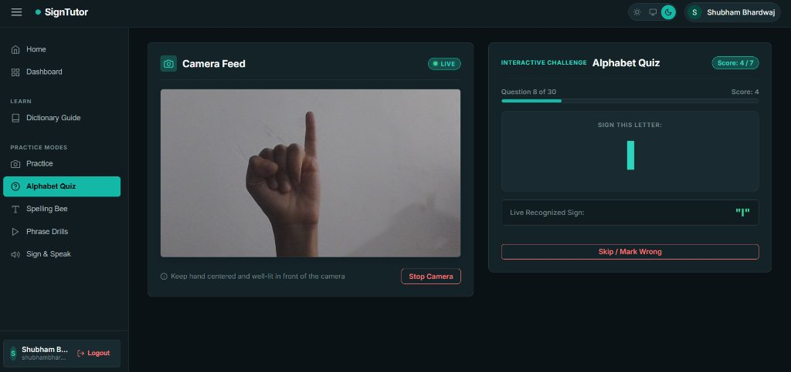
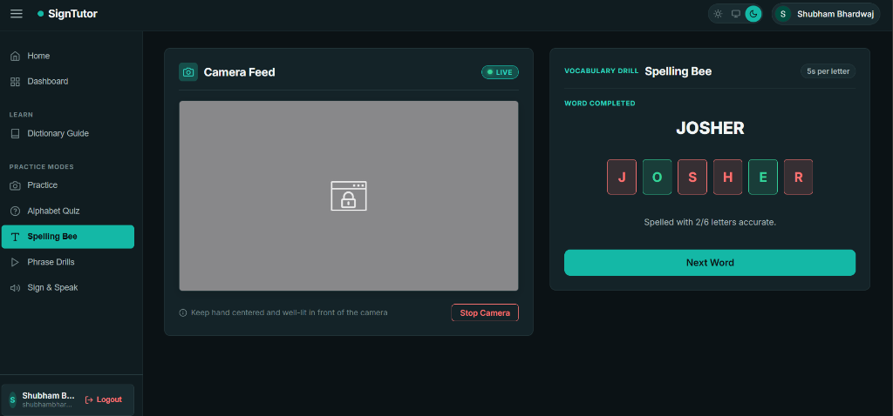
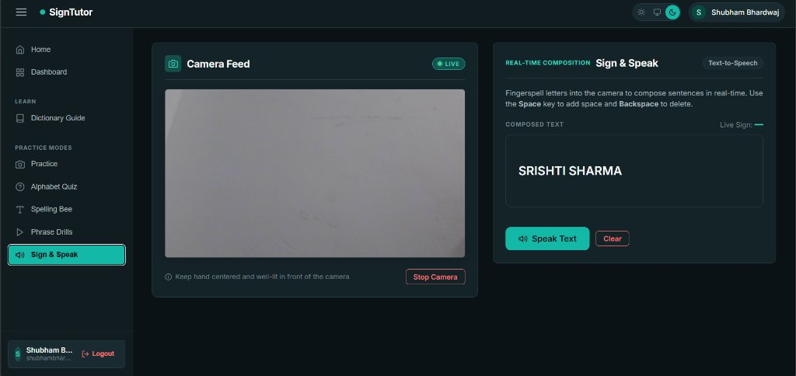
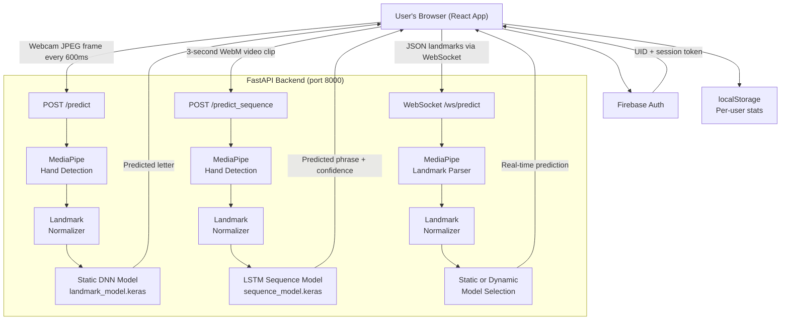

# HandSpeak — AI-Powered Sign Language Tutor

> Learn American Sign Language through real-time AI recognition, interactive quizzes, and hands-on practice — directly in your browser.

[](https://react.dev/)
[](https://fastapi.tiangolo.com/)
[](https://www.tensorflow.org/)
[](https://mediapipe.dev/)
[](https://firebase.google.com/)
[](https://www.python.org/)

**GitHub:** [https://github.com/srishtisharma07/HandSpeak](https://github.com/srishtisharma07/HandSpeak)

---

## Table of Contents

- [Project Overview](#project-overview)
- [Key Features](#key-features)
- [Screenshots](#screenshots)
- [Technology Stack](#technology-stack)
- [System Architecture](#system-architecture)
- [Machine Learning Implementation](#machine-learning-implementation)
- [Project Structure](#project-structure)
- [Installation and Setup](#installation-and-setup)
- [How to Run](#how-to-run)
- [How to Use](#how-to-use)
- [API Endpoints](#api-endpoints)
- [Dataset and Model Information](#dataset-and-model-information)
- [Future Improvements](#future-improvements)
- [Author](#author)
- [License](#license)
- [Acknowledgements](#acknowledgements)

---

## Project Overview

HandSpeak is a full-stack AI web application that teaches American Sign Language (ASL) finger-spelling through live webcam interaction. Instead of passively watching videos, users perform actual hand signs in front of their camera and receive instant feedback from two trained machine learning models running on a local backend server.

**The problem it addresses:** Sign language is a visual language that is difficult to learn from static images or text alone. Most learners have no way to verify whether they are performing signs correctly. HandSpeak bridges this gap by giving any user a real-time AI-powered tutor that recognises their hand gestures and responds immediately.

The application runs entirely on the user's machine — no cloud processing is involved during recognition. All computer vision inference happens locally through a FastAPI backend powered by MediaPipe and TensorFlow.

---

## Key Features

| Feature | Description |
|---|---|
| **Real-Time ASL Recognition** | Webcam frames are sent to the backend every 600 ms and classified by a trained neural network |
| **Dynamic Phrase Recognition** | 3-second video recordings are analysed by an LSTM model to detect multi-frame ASL phrases |
| **Alphabet Quiz** | AI-judged interactive quiz with 30 randomised letter challenges and a live score tracker |
| **Spelling Bee** | Spell a full word letter by letter using hand signs; words are fetched from a live API with a local fallback list |
| **Phrase Drills** | Practice 10 real ASL phrases (Hello, Thank You, Yes, No, Help, etc.) with AI validation |
| **Sign & Speak** | Fingerspell letters into the camera to compose text, then convert it to speech using the browser's Web Speech API |
| **Dictionary Guide** | A searchable A–Z visual reference showing the correct hand shape for every ASL letter |
| **Performance Dashboard** | Per-user heatmap of letter accuracy, fastest/slowest letters, weak spots, and quiz history |
| **User Authentication** | Secure sign-in and registration via Firebase (email/password and Google OAuth) |
| **Per-User Profiles** | Each authenticated user has their own isolated learning progress stored in localStorage |
| **Light / Dark / System Theme** | Three-way theme switcher that respects the system's colour-scheme preference |

---

## Screenshots

### Authentication — Sign In


The authentication page greets users on first launch. It supports Google sign-in and email/password login, with a "Create account" link and a Forgot Password option.

---

### Practice Mode — Real-Time ASL Recognition


The main practice screen. The left panel shows the live camera feed. The right panel displays the AI's current prediction in real time. All processing runs locally.

---

### Alphabet Quiz — Interactive Challenge


The quiz shows a target letter, activates the camera, and waits for the user to sign it correctly. Each correct answer is detected by the AI and scored automatically. The quiz runs for 30 questions.

---

### Spelling Bee — Word Challenge


The Spelling Bee presents a random word and requires the user to sign each letter in sequence. Each tile turns green for a correct letter and red for a miss. The word "JOSHER" in the screenshot shows partial completion.

---

### Sign & Speak — Text-to-Speech Composition


Users fingerspell letters into the camera to compose text in real time. Pressing **Space** adds a word gap, **Backspace** deletes the last character, and the **Speak Text** button reads the composed text aloud using the browser's speech synthesis engine.

---

## Technology Stack

### Frontend

| Technology | Purpose |
|---|---|
| React 19 | UI framework — component-based single-page application |
| React Hooks (`useRef`, `useState`, `useEffect`, `useCallback`, `useMemo`) | State management and side-effect control |
| Web Speech API | Text-to-speech for the Sign & Speak feature |
| MediaRecorder API | Captures 3-second video clips for phrase recognition |
| CSS Custom Properties | Theme variables for light, dark, and system modes |
| Firebase SDK v13 | User authentication (email/password and Google OAuth) |

### Backend

| Technology | Purpose |
|---|---|
| FastAPI | Python REST and WebSocket API server |
| Uvicorn | ASGI server that runs the FastAPI application |
| OpenCV (`cv2`) | Decodes incoming JPEG frames and WebM video files |
| python-multipart | Parses multipart file uploads from the frontend |

### Machine Learning and Computer Vision

| Technology | Purpose |
|---|---|
| MediaPipe Hands | Detects and tracks 21 hand landmarks per frame |
| TensorFlow / Keras | Trains and runs both the static and sequence ML models |
| NumPy | Numerical array operations for landmark preprocessing |
| scikit-learn | Label encoding and train/test splitting during training |

### Authentication and Data

| Technology | Purpose |
|---|---|
| Firebase Authentication | Manages user accounts, sessions, and Google OAuth |
| Browser localStorage | Stores per-user quiz statistics keyed by Firebase UID |
| Random Word API | Provides live words for the Spelling Bee challenge |

### Development Tools

| Tool | Purpose |
|---|---|
| Python `venv` | Isolated Python environment for the backend |
| Create React App | Frontend project scaffold and build tooling |
| Pandas | CSV landmark data loading during model training |

---

## System Architecture



**How it works end-to-end:**

1. The React frontend accesses the user's webcam via the browser's `getUserMedia` API.
2. For **static recognition** (letters), a JPEG frame is captured every 600 ms and sent to the `/predict` endpoint.
3. For **phrase recognition**, a 3-second WebM video is recorded using the MediaRecorder API and sent to `/predict_sequence`.
4. The backend decodes each frame with OpenCV, runs MediaPipe to extract 21 hand landmarks (63 coordinates per hand), normalises them, and feeds them to the appropriate model.
5. The model's predicted label is returned to the React app as JSON and displayed instantly.

---

## Machine Learning Implementation

### Hand Landmark Extraction

Google's **MediaPipe Hands** model detects the hand in each frame and returns 21 landmarks. Each landmark has three coordinates (x, y, z), giving 63 values per hand and 126 values when both hands are present.

### Landmark Normalisation

Raw landmark coordinates are position- and scale-dependent, so they must be normalised before being fed to the classifier. The custom `normalize_landmarks` function in `src/utils/landmark_normalizer.py` performs three steps:

1. **Mirror correction** — left hand x-coordinates are flipped so the model always sees a right-hand perspective.
2. **Translation** — the wrist landmark (index 0) is subtracted from all coordinates, making the wrist the origin.
3. **Scale normalisation** — all coordinates are divided by the maximum Euclidean distance from the wrist, so hand size does not affect the prediction.

### Static Alphabet Classification Model (`landmark_model.keras`)

- **Input:** 63 normalised landmark values (one hand, 21 × 3)
- **Architecture:** Dense(128, ReLU) → Dropout(0.3) → Dense(64, ReLU) → Dropout(0.3) → Softmax output
- **Training data:** Hand-crafted landmark CSV files (`data/landmarks/`) — one CSV per letter (A–Z), with mirrored augmentation applied during training
- **Task:** Classifies 26 ASL alphabet letters

### Dynamic Phrase Recognition Model (`sequence_model.keras`)

- **Input:** 60 consecutive frames × 126 values (two hands) = shape `(60, 126)`
- **Architecture:** LSTM(128, return_sequences=True) → Dropout(0.5) → LSTM(64) → Dropout(0.5) → Dense(64, ReLU) → Softmax output
- **Training data:** `.npy` sequence files in `data/sequence_dataset/` — one folder per phrase, each file is a 60-frame recording
- **Phrases recognised:** Hello, Bye, Yes, No, Help, Sorry, Eat, Thank You, Welcome, Stop
- **Confidence threshold:** Predictions below 70% are discarded to reduce false positives

### Training Process

**Static model training:**

```bash
python src/train_landmark_model.py
```

**Sequence data collection** (requires webcam):

```bash
python scripts/01_collect_sequences.py
```

**Sequence model training:**

```bash
python scripts/02_train_sequence_model.py
```

> **Note:** Pre-trained models are already included in the `models/` directory. You do not need to retrain unless you want to add new signs.

---

## Project Structure

```
sign-language-tutor-ml-project/
│
├── backend/                        # FastAPI server
│   ├── main.py                     # API endpoints and ML inference logic
│   ├── requirements.txt            # Backend Python dependencies
│   └── venv/                       # Backend virtual environment (not committed)
│
├── data/
│   ├── guide_images/               # SVG-based ASL reference images (A–Z)
│   ├── landmarks/                  # CSV files of collected hand landmarks (A–Z)
│   └── sequence_dataset/           # NPY sequence recordings for phrase training
│       ├── hello/
│       ├── bye/
│       ├── thank_you/
│       └── ...
│
├── frontend/                       # React web application
│   ├── public/
│   │   ├── index.html
│   │   └── data/guide_images/      # Static ASL sign images served to the browser
│   ├── src/
│   │   ├── App.js                  # Main application — all practice modes and routing
│   │   ├── App.css                 # Application styles and CSS theme variables
│   │   ├── AuthPage.js             # Authentication UI (Sign In / Sign Up / Forgot Password)
│   │   ├── AuthPage.css            # Authentication page styles
│   │   ├── firebase.js             # Firebase SDK initialisation and auth exports
│   │   └── index.js                # React entry point
│   ├── .env                        # Firebase credentials (not committed — see .env.example)
│   ├── .env.example                # Template for environment variables
│   └── package.json
│
├── models/                         # Trained model files
│   ├── landmark_model.keras        # Static ASL letter classifier
│   ├── landmark_labels.npy         # Label mapping for the static model
│   ├── sequence_model.keras        # LSTM phrase recognition model
│   └── sequence_labels.npy         # Label mapping for the sequence model
│
├── scripts/                        # Data collection and training utilities
│   ├── 01_collect_sequences.py     # Webcam-based sequence data recorder
│   ├── 02_train_sequence_model.py  # LSTM model training script
│   ├── augment_data.py             # Data augmentation helpers
│   └── train_model.py              # Alternative training entry point
│
├── src/                            # Python source utilities
│   ├── components/                 # Data ingestion and transformation modules
│   ├── utils/
│   │   └── landmark_normalizer.py  # Hand landmark normalisation function
│   ├── train_landmark_model.py     # Static classifier training script
│   ├── collect_landmarks.py        # Landmark collection from webcam
│   └── predict.py                  # Standalone prediction utilities
│
├── screenshots/                    # Application screenshots for README
├── requirements.txt                # Root Python dependencies
├── setup.py                        # Package installation setup
└── README.md
```

---

## Installation and Setup

### Prerequisites

- Python 3.10
- Node.js 18+ and npm
- A modern browser with webcam access (Chrome recommended)
- A Firebase project with Authentication enabled

---

### Step 1 — Clone the Repository

```bash
git clone https://github.com/srishtisharma07/HandSpeak.git
cd HandSpeak
```

---

### Step 2 — Set Up the Backend

Create and activate a Python virtual environment inside the `backend/` folder.

**Windows (PowerShell):**
```powershell
cd backend
python -m venv venv
.\venv\Scripts\Activate.ps1
pip install -r requirements.txt
```

**macOS / Linux:**
```bash
cd backend
python3 -m venv venv
source venv/bin/activate
pip install -r requirements.txt
```

---

### Step 3 — Set Up the Frontend

```bash
cd ../frontend
npm install
```

---

### Step 4 — Configure Firebase Credentials

Create a `.env` file inside the `frontend/` folder. Copy from the provided template:

```bash
cp frontend/.env.example frontend/.env
```

Open `frontend/.env` and fill in your Firebase project credentials:

```env
REACT_APP_FIREBASE_API_KEY=your_api_key_here
REACT_APP_FIREBASE_AUTH_DOMAIN=your_project.firebaseapp.com
REACT_APP_FIREBASE_PROJECT_ID=your_project_id
REACT_APP_FIREBASE_STORAGE_BUCKET=your_project.appspot.com
REACT_APP_FIREBASE_MESSAGING_SENDER_ID=your_sender_id
REACT_APP_FIREBASE_APP_ID=your_app_id
```

**Where to get these values:**

1. Go to [https://console.firebase.google.com](https://console.firebase.google.com)
2. Open your project → Project Settings → General → Your apps → Web app
3. Copy the Firebase SDK configuration values

Also enable the following in Firebase Console → Authentication → Sign-in method:
- **Email/Password**
- **Google**

---

## How to Run

You need **two terminals** running simultaneously — one for the backend and one for the frontend.

### Terminal 1 — Start the Backend

**Windows (PowerShell):**
```powershell
cd backend
.\venv\Scripts\Activate.ps1
uvicorn main:app --reload --port 8000
```

**macOS / Linux:**
```bash
cd backend
source venv/bin/activate
uvicorn main:app --reload --port 8000
```

The backend loads both ML models on startup and prints:
```
✅ Models loaded successfully!
INFO:     Uvicorn running on http://127.0.0.1:8000
```

### Terminal 2 — Start the Frontend

```bash
cd frontend
npm start
```

The app opens at [http://localhost:3000](http://localhost:3000)

---

## How to Use

1. **Sign in** — On first launch you are taken to the authentication page. Create an account or sign in with Google.

2. **Dictionary Guide** — Click **Dictionary Guide** in the sidebar to browse all 26 ASL letters with reference images. Use the search bar to jump to a specific letter.

3. **Practice Mode** — Click **Practice** in the sidebar. Click **Enable Camera Feed** and show any ASL hand sign to the camera. The AI translation appears in the right panel in real time.

4. **Alphabet Quiz** — Click **Alphabet Quiz**. Enable the camera, then click **Start Quiz**. The panel shows a target letter. Sign it correctly to advance. The quiz runs for 30 questions and tracks your score.

5. **Spelling Bee** — Click **Spelling Bee**. Enable the camera, then click **Start New Word**. A random word is fetched. Sign each letter in sequence — the tile turns green for correct and red for wrong.

6. **Phrase Drills** — Click **Phrase Drills**. Enable the camera, then click **Start Phrase**. A target phrase appears. Perform the full ASL sign for that phrase within 10 seconds.

7. **Sign & Speak** — Click **Sign & Speak**. Enable the camera. Fingerspell letters to compose text. Use **Space** for word gaps and **Backspace** to delete. Click **Speak Text** to hear your composed text read aloud.

8. **Dashboard** — Click **Dashboard** to view your personal learning analytics: overall accuracy, a per-letter heatmap (green = good, yellow = average, red = needs work), fastest and slowest letters, and your three weakest spots.

---

## API Endpoints

### REST Endpoints

| Method | Endpoint | Description |
|---|---|---|
| `GET` | `/` | Health check — returns a status message |
| `POST` | `/predict` | Accepts a JPEG image (multipart); returns `{ "label": "A" }` |
| `POST` | `/predict_sequence` | Accepts a WebM video (multipart); returns `{ "label": "Hello", "confidence": 0.92 }` |

#### `/predict` — Static Sign Recognition

**Request:** `multipart/form-data` with field `file` containing a JPEG image

**Response:**
```json
{ "label": "A" }
```
An empty string is returned when no hand is detected.

#### `/predict_sequence` — Phrase Recognition

**Request:** `multipart/form-data` with field `file` containing a WebM video clip (must yield at least 60 frames)

**Response:**
```json
{ "label": "Thank You", "confidence": 0.87 }
```
An empty label is returned when confidence is below 70%.

---

### WebSocket Endpoint

| Endpoint | Description |
|---|---|
| `ws://127.0.0.1:8000/ws/predict` | Real-time streaming prediction for both static and dynamic modes |

The WebSocket accepts JSON messages with a `mode` field:

- `"mode": "static"` with 63 landmark values → returns predicted letter
- `"mode": "dynamic"` with 126 landmark values → buffers frames and returns phrase when confident
- `"mode": "reset"` → clears the sequence buffer

---

## Dataset and Model Information

### Static Landmark Dataset

Located in `data/landmarks/`. Each file is a CSV named after a letter (e.g., `A.csv`). Each row contains 63 floating-point values — the x, y, z coordinates of all 21 MediaPipe hand landmarks for one frame of that sign. These were collected manually using a webcam and the `src/collect_landmarks.py` script.

### Sequence Dataset

Located in `data/sequence_dataset/`. Each subfolder is named after a phrase (e.g., `hello/`, `thank_you/`). Each `.npy` file inside is a `(60, 126)` array representing one recorded video clip of that phrase — 60 consecutive frames, each with 126 landmark values (two hands × 21 landmarks × 3 coordinates).

### Trained Models (included in the repository)

| File | Type | Input Shape | Purpose |
|---|---|---|---|
| `models/landmark_model.keras` | Dense neural network | `(63,)` | Classify 26 ASL alphabet letters |
| `models/landmark_labels.npy` | NumPy array | — | Letter label mapping for the static model |
| `models/sequence_model.keras` | LSTM network | `(60, 126)` | Recognise 10 ASL phrases |
| `models/sequence_labels.npy` | NumPy array | — | Phrase label mapping for the sequence model |

> All trained models are committed to the repository. No external download is required.

---

## Future Improvements

- **Expanded phrase vocabulary** — Add more ASL phrases and words beyond the current 10.
- **Two-hand static recognition** — The current static model only uses one hand; some letters (like H, K, R) could be improved with two-hand input.
- **Confidence score display** — Show the AI's confidence percentage alongside each prediction in the UI.
- **Cloud-hosted backend** — Deploy the FastAPI backend to a cloud service so the app does not require local setup.
- **Progress persistence** — Move learning statistics from localStorage to a cloud database (Firestore) for access across devices.
- **Mobile support** — Optimise the camera and layout for mobile browsers.
- **Sentence-level recognition** — Combine static letter recognition with language modelling to predict full words from fingerspelling sequences.
- **Leaderboard** — Compare quiz scores between registered users.

---

## Author

Developed by:

**Srishti Sharma**  
GitHub: [https://github.com/srishtisharma07](https://github.com/srishtisharma07)

---

## License

This project does not currently include a licence file. All rights are reserved by the author unless stated otherwise.

---

## Acknowledgements

- [Google MediaPipe](https://mediapipe.dev/) — hand landmark detection model
- [TensorFlow / Keras](https://www.tensorflow.org/) — neural network training and inference
- [FastAPI](https://fastapi.tiangolo.com/) — backend API framework
- [Firebase](https://firebase.google.com/) — user authentication
- [Random Word API](https://random-word-api.herokuapp.com/) — word generation for the Spelling Bee feature
- [shields.io](https://shields.io/) — README badge generation
